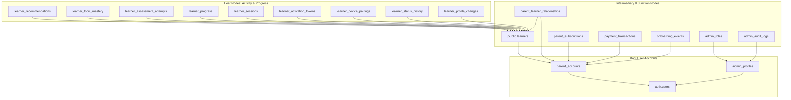

# LearnTZ Demo Data Removal Manifest & Dependency Order

**Document ID:** `LTZ-CLEANUP-MAN-001`  
**Target Environment:** LearnTZ Remote Production (`jmllsuohmllklzhmhiva.supabase.co`)  
**Audit Date:** 2026-11-16  
**Status:** READY FOR VERIFIED EXECUTION  

---

## 1. Foreign-Key Dependency Graph

Deleting demo data from PostgreSQL without adhering to the precise relational dependency hierarchy will trigger foreign-key constraint violations (`23503: foreign_key_violation`). 

The relational graph below outlines the cascading tree of child tables that depend upon `learners`, `parent_accounts`, and `admin_profiles`:



---

## 2. Controlled Execution Sequence

The cleanup must be executed inside a single, atomic PostgreSQL transaction (`BEGIN ... COMMIT`). If any constraint is violated or any integrity assertion fails, the entire transaction automatically rolls back (`ROLLBACK`).

### Step 1: Pre-Execution Safety Assertions
Verify that:
1. The genuine Super Admin account `bonimwangi243@gmail.com` is present and active.
2. Verified TIE English Standards III–VI subjects (`tie-pri-english-standard3` through `standard6`) exist and have 81 subtopics.
3. Only entities with `is_demo = true` or matching the deterministic demo UUID ranges (`d1000000-%`, `d2000000-%`, `d3000000-%`) are selected for deletion.

---

### Step 2: Cascade Removal Queries

#### Stage 2.1: Purge Demo Learner Activity & Leaf Records
```sql
-- 1. Recommendations
delete from public.learner_recommendations
where learner_id in (select id from public.learners where is_demo = true or id::text like 'd2000000-%');

-- 2. Topic Mastery
delete from public.learner_topic_mastery
where learner_id in (select id from public.learners where is_demo = true or id::text like 'd2000000-%');

-- 3. Assessment Attempts
delete from public.learner_assessment_attempts
where learner_id in (select id from public.learners where is_demo = true or id::text like 'd2000000-%');

-- 4. Progress Records
delete from public.learner_progress
where learner_id in (select id from public.learners where is_demo = true or id::text like 'd2000000-%');

-- 5. Learner Sessions
delete from public.learner_sessions
where learner_id in (select id from public.learners where is_demo = true or id::text like 'd2000000-%');

-- 6. Activation PIN Tokens
delete from public.learner_activation_tokens
where learner_id in (select id from public.learners where is_demo = true or id::text like 'd2000000-%');

-- 7. Device Pairings (if table exists)
do $$
begin
  if exists (select 1 from information_schema.tables where table_schema = 'public' and table_name = 'learner_device_pairings') then
    execute 'delete from public.learner_device_pairings where learner_id in (select id from public.learners where is_demo = true or id::text like ''d2000000-%'')';
  end if;
end $$;

-- 8. Learner Status History & Profile Changes
delete from public.learner_status_history
where learner_id in (select id from public.learners where is_demo = true or id::text like 'd2000000-%');

delete from public.learner_profile_changes
where learner_id in (select id from public.learners where is_demo = true or id::text like 'd2000000-%');

-- 9. Parent-Learner Relationships
delete from public.parent_learner_relationships
where learner_id in (select id from public.learners where is_demo = true or id::text like 'd2000000-%')
   or parent_user_id in (select user_id from public.parent_accounts where is_demo = true or user_id::text like 'd1000000-%');
```

---

#### Stage 2.2: Purge Demo Learners
```sql
delete from public.learners
where is_demo = true or id::text like 'd2000000-%';
```

---

#### Stage 2.3: Purge Demo Commercial & Onboarding Data
```sql
-- 1. Onboarding Events
delete from public.onboarding_events
where parent_id in (select user_id from public.parent_accounts where is_demo = true or user_id::text like 'd1000000-%');

-- 2. Payment Transactions
delete from public.payment_transactions
where is_demo = true or parent_user_id in (select user_id from public.parent_accounts where is_demo = true or user_id::text like 'd1000000-%');

-- 3. Parent Subscriptions
delete from public.parent_subscriptions
where is_demo = true or parent_user_id in (select user_id from public.parent_accounts where is_demo = true or user_id::text like 'd1000000-%');
```

---

#### Stage 2.4: Purge Demo Parent Accounts
```sql
delete from public.parent_accounts
where is_demo = true or user_id::text like 'd1000000-%';

delete from public.profiles
where id::text like 'd1000000-%';
```

---

#### Stage 2.5: Purge Demo Administrators
```sql
-- 1. Audit Logs generated by demo admins
delete from public.admin_audit_logs
where admin_id in (select id from public.admin_profiles where is_demo = true or id::text like 'd3000000-%');

-- 2. Admin Roles
delete from public.admin_roles
where admin_id in (select id from public.admin_profiles where is_demo = true or id::text like 'd3000000-%');

-- 3. Admin Profiles
delete from public.admin_profiles
where is_demo = true or id::text like 'd3000000-%';
```

---

#### Stage 2.6: Purge Demo Auth Users (`auth.users`)
```sql
delete from auth.users
where id::text like 'd1000000-%'
   or id::text like 'd3000000-%'
   or email like '%@demo.learntz.test';
```

---

#### Stage 2.7: Archive Legacy & Placeholder Curriculum Data
```sql
-- Archive legacy dummy subjects
update public.subjects
set is_active = false
where id in ('tie-hisabati', 'tie-kiswahili', 'tie-sayansi', 'tie-primary-english');

-- Archive umbrella placeholder subjects (grade_id IS NULL)
update public.subjects
set is_active = false
where id in (
  'tie-pri-arts',
  'tie-pri-chinese',
  'tie-pri-geography',
  'tie-pri-history',
  'tie-pri-kiswahili',
  'tie-pri-mathematics',
  'tie-pri-science'
) and grade_id is null;
```

---

### Step 3: Post-Execution Verification Assertions
At the conclusion of the migration, the transaction must assert the following conditions:

```sql
do $$
declare
  v_real_user_exists boolean;
  v_english_topics int;
  v_demo_user_count int;
begin
  -- 1. Check real user
  select exists (
    select 1 from auth.users where email = 'bonimwangi243@gmail.com'
  ) into v_real_user_exists;
  if not v_real_user_exists then
    raise exception 'FATAL SAFETY VIOLATION: Genuine Super Admin user bonimwangi243@gmail.com is missing!' using errcode = 'P0001';
  end if;

  -- 2. Check English curriculum
  select count(*) into v_english_topics
  from public.topics
  where subject_id in ('tie-pri-english-standard3', 'tie-pri-english-standard4', 'tie-pri-english-standard5', 'tie-pri-english-standard6');
  if v_english_topics != 28 then
    raise exception 'FATAL SAFETY VIOLATION: Verified English topics count is % (expected 28)!', v_english_topics using errcode = 'P0001';
  end if;

  -- 3. Verify zero demo users remain
  select count(*) into v_demo_user_count
  from auth.users
  where email like '%@demo.learntz.test';
  if v_demo_user_count > 0 then
    raise exception 'CLEANUP INCOMPLETE: % demo users remain in auth.users!', v_demo_user_count using errcode = 'P0001';
  end if;
end $$;
```

---

## 3. Rollback & Disaster Recovery Plan

If any unexpected error occurs:
1. **Transaction Atomicity:** Because all DDL and DML operations execute within `begin; ... commit;`, any error will automatically trigger an immediate rollback, leaving the database in its exact prior state.
2. **Point-in-Time Recovery (PITR):** Supabase maintains automated daily backups and write-ahead logs (WAL) for disaster recovery.
3. **Re-provisioning Capability:** If required in local development, `scripts/provision_demo_accounts.py` can re-seed the test dataset in an isolated non-production environment.
