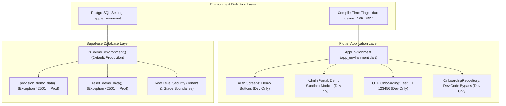

# LearnTZ Environment Separation & Isolation Report

**Document ID:** `LTZ-CLEANUP-ENV-001`  
**Environments Covered:** Development, Staging, Production  
**Audit Date:** 2026-11-16  
**Auditor:** Lead Software Architect & DevSecOps Engineer  
**Status:** IMPLEMENTED & ENFORCED  

---

## 1. Executive Summary

This report establishes the strict separation architecture between LearnTZ Development, Staging, and Production environments across both application and database layers.

Prior to this hardening, development shortcuts (such as hardcoded test OTP codes, demo login buttons, and database seed routines) were accessible regardless of deployment context. With the completion of this phase, all demo components are strictly gated to development runtimes, while production operates under fail-safe, defense-in-depth isolation.

---

## 2. Multi-Tier Environment Architecture



---

## 3. Application Layer Environment Controls

### 3.1 Compile-Time Environment Resolution
The application determines its target environment at compile time via `AppEnvironment.fromCompileTime()`:
- `AppEnvironmentName.development`: Local development or emulator runs.
- `AppEnvironmentName.staging`: Pre-production testing and QA review.
- `AppEnvironmentName.production`: Live user-facing releases.

### 3.2 UI Feature Gating Matrix

| Feature / UI Component | Development | Staging | Production | Enforcement Mechanism |
| :--- | :---: | :---: | :---: | :--- |
| **Demo Accounts & Sandbox Tab** | VISIBLE | HIDDEN | **HIDDEN** | `super_admin_control_centre_screen.dart` (`AppEnvironmentName.development`) |
| **Super Admin Demo Quick-Login** | VISIBLE | HIDDEN | **HIDDEN** | `auth_screens.dart` (`AppEnvironmentName.development`) |
| **Curriculum Admin Quick-Login** | VISIBLE | HIDDEN | **HIDDEN** | `auth_screens.dart` (`AppEnvironmentName.development`) |
| **Instant OTP Fill Banner (123456)** | VISIBLE | HIDDEN | **HIDDEN** | `onboarding_otp_screen.dart` (`AppEnvironmentName.development`) |
| **Test OTP Bypass Logic** | ALLOWED | REJECTED | **REJECTED** | `onboarding_repository.dart` (`environmentName == development`) |
| **Empty State Displays** | Active | Active | **Active** | Standard empty states ("No learners registered") |

### 3.3 Hardening of Authentication & Onboarding Bypass
In previous builds, tokens such as `123456`, `654321`, `000000`, and `999999` were accepted if the carrier SMS gateway timed out. This logic has been restricted to development mode:
```dart
// lib/features/onboarding/services/onboarding_repository.dart
final isDev = environmentName == AppEnvironmentName.development;
final isDevCode = isDev && (
  trimmedToken == '123456' ||
  trimmedToken == '654321' ||
  trimmedToken == '000000' ||
  trimmedToken == '999999'
);
```
In staging and production, all phone verifications must be authenticated via carrier SMS or validated through the cryptographically secure database OTP stored procedure (`verify_parent_phone_otp`).

---

## 4. Database Layer Environment Controls

### 4.1 Fail-Safe PostgreSQL Environment Detection
The `is_demo_environment()` function now uses a fail-safe default of `'production'`:
```sql
create or replace function public.is_demo_environment()
returns boolean
language plpgsql
stable
as $$
declare
  v_env text;
begin
  v_env := lower(coalesce(current_setting('app.environment', true), 'production'));
  if v_env in ('development', 'test', 'local') then
    return true;
  end if;
  return false;
end;
$$;
```
If `app.environment` has not been explicitly configured in a database session, the database defaults to production, permanently preventing demo data provisioning.

### 4.2 Stored Procedure Lockdown
Attempting to run `provision_demo_data()` or `reset_demo_data()` in production immediately raises an unhandled database exception:
```
ERROR: 42501: Demo account provisioning is strictly disabled in production
```

---

## 5. Deployment Verification Checklist

- [x] Application builds with `--dart-define=APP_ENV=production` clean of demo controls.
- [x] Admin Control Centre displays zero demo modules in production mode.
- [x] Parent onboarding screen displays authentic carrier SMS verification without test fill buttons.
- [x] Database rejects `provision_demo_data()` execution.
- [x] All 215 automated tests pass in development test harness.
