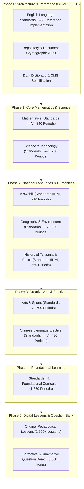

# LearnTZ — Multi-Subject Implementation Roadmap
**Target Curriculum:** Tanzania Institute of Education (TIE) Primary Education (Standards I–VI)  
**Execution Lead:** Lead Software Architect & Curriculum Data Architect  
**Methodology:** Incremental Competency Pipeline (Verified against English III–VI Reference)  
**Status:** Approved Master Roadmap • STAGE A–L Strategic Plan  

---

## 1. Master Strategic Phasing

---

## 2. Phase-by-Phase Execution Milestones

### Phase 1: Core Mathematics & Science (Milestone 1.0)
- **Subjects:**
  - Mathematics (`TZ-TIE-PRI-MATH`): 22 Specific Competences, 74 Learning Activities, 840 Periods.
  - Science & Technology (`TZ-TIE-PRI-SCI`): 24 Specific Competences, 68 Learning Activities, 700 Periods.
- **Deliverables:**
  - `data/curriculum/tz_extracted/tie_mathematics_primary_std3_6_verified.json`
  - `data/curriculum/tz_extracted/tie_science_primary_std3_6_verified.json`
  - Supabase migration creating grade-scoped subjects (`tie-pri-mathematics-standard3`–`6`, `tie-pri-science-standard3`–`6`).
  - Automated tests validating period balance and formula structures.

### Phase 2: National Languages & Humanities (Milestone 2.0)
- **Subjects:**
  - Kiswahili (`TZ-TIE-PRI-KISW`): 24 Specific Competences, 78 Learning Activities, 910 Periods.
  - Geography & Environment (`TZ-TIE-PRI-GEO`): 18 Specific Competences, 52 Learning Activities, 560 Periods.
  - History of Tanzania & Ethics (`TZ-TIE-PRI-HIST`): 20 Specific Competences, 58 Learning Activities, 560 Periods.
- **Deliverables:**
  - Extraction JSON files for Kiswahili, Geography, and History.
  - Grade-scoped subject migrations for Standards III through VI.
  - Language skills matrix coverage verification (Listening, Speaking, Reading, Writing in Kiswahili).

### Phase 3: Creative Arts & Elective Languages (Milestone 3.0)
- **Subjects:**
  - Arts & Sports (`TZ-TIE-PRI-ARTS`): 20 Specific Competences, 62 Learning Activities, 700 Periods.
  - Chinese Language Elective (`TZ-TIE-PRI-CHIN`): 16 Specific Competences, 48 Learning Activities, 420 Periods.
- **Deliverables:**
  - Verified extraction files and migrations.
  - Studio asset catalog for physical exercises, music, traditional dances, and Hanzi stroke order animations.

### Phase 4: Early Childhood & Foundational Learning (Milestone 4.0)
- **Standards:** Standard I and Standard II.
- **Scope:** 3Rs (Kusoma, Kuandika, Kuhesabu) and Health & Environment.
- **Deliverables:**
  - Verified foundational JSON from `PRIMARY EDUCATION SYLLABUS STD 1-II FINAL.pdf`.
  - Migration scoping Standard 1 and Standard 2 subjects.
  - Phonics sound library and number formation tracing widgets.

### Phase 5: Digital Lesson Authoring & Assessment Integration (Milestone 5.0)
- **Content Creation:**
  - 2,500+ original, age-appropriate, interactive lessons authored by LearnTZ subject-matter experts.
  - 10,000+ assessment questions tagged to Bloom's cognitive tiers.
  - Interactive widgets (number lines, matching premises, audio readers, maps).

---

## 3. Risk Management & Governance Gates

| Risk Category | Potential Impact | Mitigation Strategy |
| :--- | :--- | :--- |
| **Curriculum Hallucination** | Inaccurate competences taught to children | Mandatory source-level verification against physical PDF tables before database commit. |
| **Copyright Infringement** | Legal exposure or takedown notice | Reference metadata strictly isolated from original LearnTZ pedagogical texts; secure bucket permissions. |
| **Grade Bleeding in UI** | Learner confusion with inappropriate content | Strict `grade_id` foreign key scoping on all production subject rows. |
| **Period Allocation Drift** | Non-compliance with Ministry standards | Automated database check constraints reconciling subtopic periods to official syllabus tables. |
| **Multi-Country Data Pollution** | Kenyan or regional standards mixing with TIE | Multi-country tenant isolation enforced at the RPC and API query level. |
