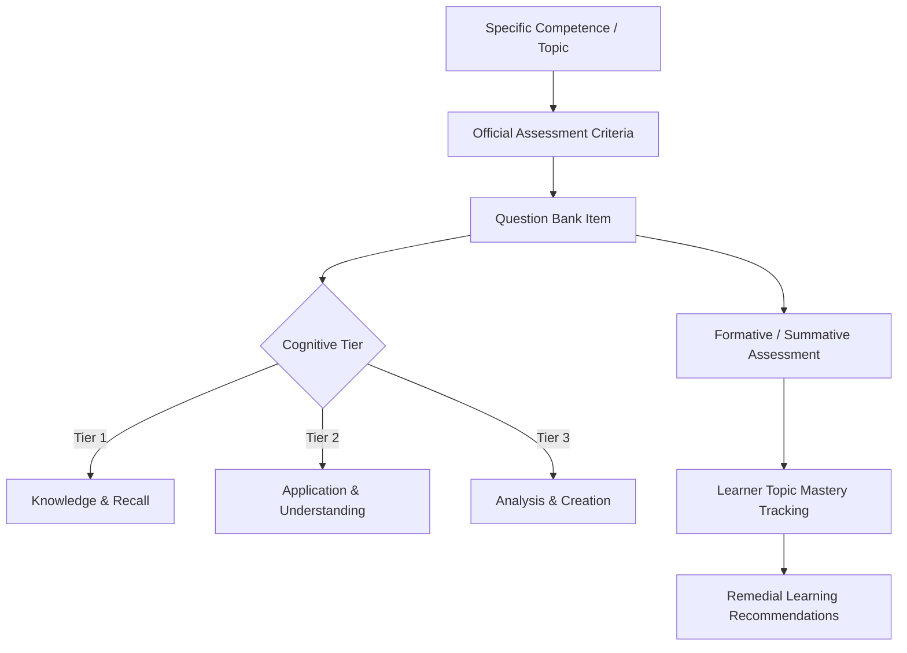

# LearnTZ — TIE Assessment Alignment Report
**Framework:** Competency-Based Assessment Architecture (CBA)  
**Target Curriculum:** Tanzania Institute of Education (TIE) 2023 Primary Curriculum  
**Cognitive Model:** Bloom's Revised Educational Taxonomy  
**Status:** Architecture Specified • STAGE I Deliverable  

---

## 1. Assessment Architecture & Philosophy

In accordance with TIE's Competency-Based Education model, assessments in LearnTZ measure what learners **can do** (demonstrable competencies) rather than rote memorization. Every evaluation item connects directly to a verified Specific Competence code and its official assessment criteria.

---

## 2. Supported Assessment Item Types

LearnTZ supports 10 distinct assessment item types tailored to primary education developmental stages:

| Item Type | Description | Primary Target Disciplines | Schema Representation |
| :--- | :--- | :--- | :--- |
| **Multiple Choice (MCQ)** | 3–4 plausible distractors with single correct key | All Subjects | `question_type = 'multiple_choice'`, options list |
| **True / False** | Propositional truth validation | Science, Geography, History | `question_type = 'true_false'`, binary boolean |
| **Matching (Premise / Response)** | Connecting items, definitions, symbols, or terms | Mathematics, Kiswahili, English, Science | `question_type = 'matching'`, premise-response JSON map |
| **Fill-in-the-Blank** | Cloze reading, grammatical inflections, number sentences | English, Kiswahili, Mathematics | `question_type = 'fill_blank'`, target token |
| **Short Answer** | Concise 1–2 sentence conceptual explanations | Science, Social Studies, History | `question_type = 'short_answer'`, keyword rubrics |
| **Reading Comprehension** | Passage-driven analytical questions | English, Kiswahili | Passages with nested question sets |
| **Listening Assessment** | Audio stimulus with oral comprehension questions | English, Kiswahili, Chinese | Audio clip asset with response items |
| **Speaking Assessment** | Pronunciation, oral dialogue, storytelling prompts | English, Kiswahili, Chinese | Audio recording submission rubrics |
| **Writing Composition** | Letter writing, paragraph composition, creative stanza | English, Kiswahili | Multi-paragraph rubrics |
| **Practical Problem Solving** | Multi-step mathematical calculations, map reading | Mathematics, Geography, Science | Step-by-step calculation entries |

---

## 3. Four Language Skills Integration (English & Kiswahili)

For language subjects (English Language, Kiswahili, Chinese), assessments systematically cover all four foundational language skills:

1. **Listening (Kusikiliza):**
   - *Stimulus:* Recorded audio dialogue, short narrative, or dictation sentences.
   - *Assessment:* Question answering, picture selection matching audio descriptions, or spelling dictation.
2. **Speaking (Kuzungumza):**
   - *Stimulus:* Dialogue situations, picture prompts, emotional role-play scenarios.
   - *Assessment:* Intonation modulation, conversational backchannels, polite inquiry formula.
3. **Reading (Kusoma):**
   - *Stimulus:* Decodable texts, simple narrative stories, expository articles, timetables/charts.
   - *Assessment:* Oral reading fluency, skimming for gist, scanning for specific detail, inferential comprehension.
4. **Writing (Kuandika):**
   - *Stimulus:* Guided sentence building, friendly letters, apology notes, creative stanzas.
   - *Assessment:* Punctuation accuracy, spelling, organizational layout, syntactic correctness.

---

## 4. Subject-Specific Evaluation Protocols

- **Mathematics:** Assesses conceptual understanding of numbers, operational fluency (addition, subtraction, multiplication, division), geometric visualization, measurement conversions, and everyday financial problem solving.
- **Science & Technology:** Evaluates observation of natural phenomena, scientific inquiry, health habits, environmental stewardship, and basic technological device handling.
- **Geography & Environment:** Evaluates orientation, cardinal directions, local map interpretation, solar system awareness, weather observation, and conservation ethics.
- **History & Ethics:** Evaluates patriotic values, national heroes, cultural heritage, democratic understanding, and communal problem solving.
- **Arts & Sports:** Evaluates visual drawing/coloring, rhythmic movement, traditional songs, gymnastics balance, and sportsmanship.

---

## 5. Mastery Tracking & Remedial Pipeline

Assessment attempts recorded in `public.learner_assessment_attempts` compute topic-level proficiency stored in `public.learner_topic_mastery`:
- **Mastery Score >= 80%:** Topic marked as *Mastered*; unlocks advanced challenges and badges.
- **Mastery Score 50%–79%:** Marked as *In Progress*; suggests practice drills.
- **Mastery Score < 50%:** Flags *Learning Gap*; triggers automatic `learner_recommendations` pointing to specific foundation lessons.
