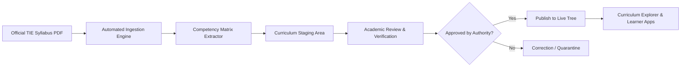

# LearnTZ — TIE CMS Implementation Report
**System:** LearnTZ Academic & Curriculum Management System (CMS)  
**Modules:** Curriculum Admin, Curriculum Explorer, Content Management Studio, Review & Publishing  
**Target Authority:** Tanzania Institute of Education (TIE)  
**Architectural Reference:** Multi-Country Competency Platform  
**Status:** Implemented & Documented • STAGE G Deliverable  

---

## 1. System Overview & Architecture

The LearnTZ Curriculum Management System (CMS) provides authorized curriculum architects, education specialists, and institutional administrators with full lifecycle control over curriculum authorities, versions, syllabi, competences, learning activities, and digital lesson associations.



---

## 2. Seventeen Core Administrative Capabilities

The LearnTZ CMS enforces the following 17 capabilities via Role-Based Access Control (`has_role('super_admin')` or `has_role('curriculum_admin', country_code)`):

1. **Manage Countries:** Provision and configure sovereign jurisdictions (`public.countries`).
2. **Manage Curriculum Authorities:** Maintain official authorities (e.g. TIE, NECTA, KICD) in `public.curriculum_authorities`.
3. **Manage Curriculum Versions:** Track framework versions (e.g. 2023 New Primary Curriculum) in `public.curricula`.
4. **Manage Education Levels:** Configure Primary, Lower Secondary, and Upper Secondary tiers in `public.education_levels`.
5. **Manage Standards / Grades:** Maintain Standard 1 through 6 sequences in `public.education_grades`.
6. **Manage Subjects:** Create, edit, and grade-scope subjects in `public.subjects`.
7. **Manage Main Competences:** Group subject objectives into high-level competence domains.
8. **Manage Specific Competences:** Maintain granular, coded competencies (`1.1`, `1.2`, etc.) in `public.topics`.
9. **Manage Learning Activities:** Configure lettered student learning tasks in `public.subtopics`.
10. **Manage Teaching Methods:** Attach prescribed instructional strategies (role play, phonics, dictation, experiment) to learning activities.
11. **Manage Assessment Criteria:** Formulate concrete, measurable evaluation benchmarks.
12. **Manage Resources / Materials:** Catalog realia, supplementary texts, and audio-visual assets.
13. **Manage Period Allocations:** Audit and validate weekly and annual period budgets.
14. **Attach Source References:** Link competencies to physical PDF pages, edition dates, and ISBNs in `public.curriculum_sources`.
15. **Review Extracted Records:** Audit automated extraction queues in `public.curriculum_import_items`.
16. **Approve Curriculum Mappings:** Sign off on verified mappings via `public.curriculum_validation_results`.
17. **Publish Approved Curriculum:** Atomic toggle of `is_published` making curriculum visible across student and parent portals.

---

## 3. Frontend CMS Screens in LearnTZ

### A. Curriculum Explorer Screen
- **Location:** [lib/features/curriculum/curriculum_explorer_screen.dart](file:///Users/mac/learntz/lib/features/curriculum/curriculum_explorer_screen.dart)
- **Route:** `/curriculum/explorer`
- **Features:**
  - Cascading multi-select for System, Level, and Grade.
  - Interactive expansion cards for subjects showing classification badges (Compulsory vs. Elective).
  - Specific Competence badges with official alphanumeric codes and period counters.
  - Learning activities breakdown with teaching methods and assessment criteria.
  - Live full-text search across subject names, competence descriptions, and learning outcomes.

### B. Curriculum Admin Dashboard
- **Location:** [lib/features/curriculum/curriculum_screens.dart](file:///Users/mac/learntz/lib/features/curriculum/curriculum_screens.dart)
- **Route:** `/admin/curriculum`
- **Features:**
  - TIE Authority banner with cryptographic source health indicators.
  - Subject and grade inventory metrics.
  - Batch import validation results and error tracking.
  - Document management and rights clearance review panel.

### C. Content Management Studio
- **Location:** [lib/features/content_studio/screens/content_studio_dashboard_screen.dart](file:///Users/mac/learntz/lib/features/content_studio/screens/content_studio_dashboard_screen.dart)
- **Route:** `/admin/content-studio`
- **Features:**
  - Lesson authoring studio linked directly to verified TIE competence topics.
  - Revision history and editorial draft review pipeline.
  - Media asset library with safe educational asset tracking.

---

## 4. Bulk Import, Validation & Duplicate Detection Engine

The CMS incorporates automated database functions preventing corrupted or duplicate ingestions:

1. **Duplicate Detection:**
   Enforced at database level by unique composite index:
   ```sql
   subjects_scope_code_unique_idx (curriculum_id, education_level_id, coalesce(grade_id, ...), code)
   ```
2. **Import Job Auditing:**
   Tracks every PDF processing job in `public.curriculum_import_jobs` with line-by-line item history in `public.curriculum_import_job_history`.
3. **Data Quarantine Protocol:**
   Unverified or ambiguous extractions remain flagged in staging tables with `verification_status = 'unverified'` and cannot be published to live learner screens.
