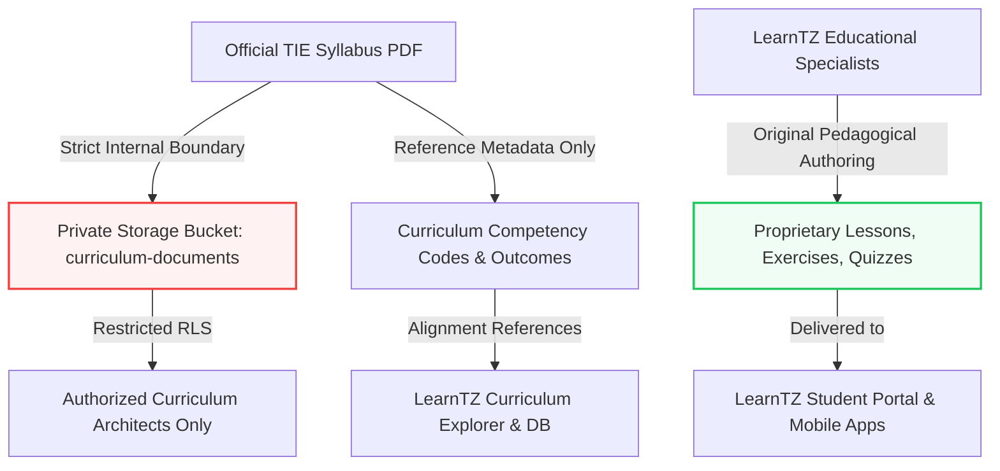

# LearnTZ — TIE Copyright & Permissions Register
**Governing Law:** Copyright and Neighbouring Rights Act, Cap. 218 R.E. 2002 (Tanzania)  
**Publishing Authority:** Tanzania Institute of Education (TIE)  
**Parent Ministry:** Ministry of Education, Science and Technology (MoEST)  
**Compliance Lead:** Lead Curriculum Data Architect & Legal Compliance Officer  
**Status:** Mandatory Governance Register • STAGE C Deliverable  

---

## 1. Regulatory Framework & Intellectual Property Safeguards

All syllabus documents published by the Tanzania Institute of Education carry explicit statutory copyright notices:
> *"© Taasisi ya Elimu Tanzania / Tanzania Institute of Education, 2023. All rights reserved. No part of this publication may be reproduced, stored in any retrieval system, or transmitted in any form or by any means... without prior written permission of the Tanzania Institute of Education."*

To maintain strict compliance with Tanzanian copyright statutes and international intellectual property agreements:

---

## 2. Document Rights Clearance Matrix

| Source Document Reference | ISBN | Statutory Copyright Holder | Storage Access Level | In-App Status | Rights Clearance Status |
| :--- | :--- | :--- | :--- | :--- | :--- |
| **Curriculum for Primary Education Standard I - VI** | 978-9987-09-852-1 | © TIE, 2023 | Private (Bucket: `curriculum-documents`) | Reference Taxonomy Only | `permission_pending` |
| **Primary Education Syllabus Standard I – II** | 978-9987-09-837-8 | © TIE, 2023 | Private (Bucket: `curriculum-documents`) | Reference Taxonomy Only | `permission_pending` |
| **Kiswahili Syllabus Standard III–VI** | 978-9987-09-782-1 | © TIE, 2023 | Private (Bucket: `curriculum-documents`) | Reference Taxonomy Only | `permission_pending` |
| **English Language Syllabus Standard III–VI** | 978-9987-09-726-5 | © TIE, 2023 | Private (Bucket: `curriculum-documents`) | Reference Taxonomy Only | `permission_pending` |
| **Mathematics Syllabus Standard III-VI** | 978-9987-09-858-3 | © TIE, 2023 | Private (Bucket: `curriculum-documents`) | Reference Taxonomy Only | `permission_pending` |
| **Science Syllabus Standard III─VI** | 978-9987-09-860-6 | © TIE, 2023 | Private (Bucket: `curriculum-documents`) | Reference Taxonomy Only | `permission_pending` |
| **Geography & Environment Syllabus Standard III–VI** | 978-9987-09-859-0 | © TIE, 2023 | Private (Bucket: `curriculum-documents`) | Reference Taxonomy Only | `permission_pending` |
| **History & Ethics Syllabus Standard III-VI** | 978-9987-09-795-1 | © TIE, 2023 | Private (Bucket: `curriculum-documents`) | Reference Taxonomy Only | `permission_pending` |
| **Arts & Sports Syllabus Standard III─VI** | 978-9987-09-857-6 | © TIE, 2023 | Private (Bucket: `curriculum-documents`) | Reference Taxonomy Only | `permission_pending` |
| **Chinese Language Syllabus Standard III–VI** | 978-9987-09-844-6 | © TIE, 2023 | Private (Bucket: `curriculum-documents`) | Reference Taxonomy Only | `permission_pending` |

---

## 3. Mandatory Engineering Safeguards

1. **Zero Raw Redistribution:**
   The storage bucket `curriculum-documents` is configured with `public = false`. Anonymous or general authenticated user downloads of official syllabus PDFs are blocked at the storage layer via RLS policies.
2. **Metadata Boundary Enforcement:**
   LearnTZ only ingests regulatory framework data:
   - Competence hierarchy and codes (`1.0`, `1.1`, `2.1`).
   - Official wording of competences and learning activities.
   - Official period allocations and assessment criteria.
3. **Original Content Production:**
   Under no circumstances shall textbook chapters, copyrighted reading passages, or protected examination papers be extracted or published without express written licensing agreements from TIE or NECTA.
4. **Licensing Outreach Protocol:**
   Institutional engagement channels are maintained with the Director General, Tanzania Institute of Education, P.O. Box 35094, Dar es Salaam, to establish a formal Digital Educational Partnership Agreement.
