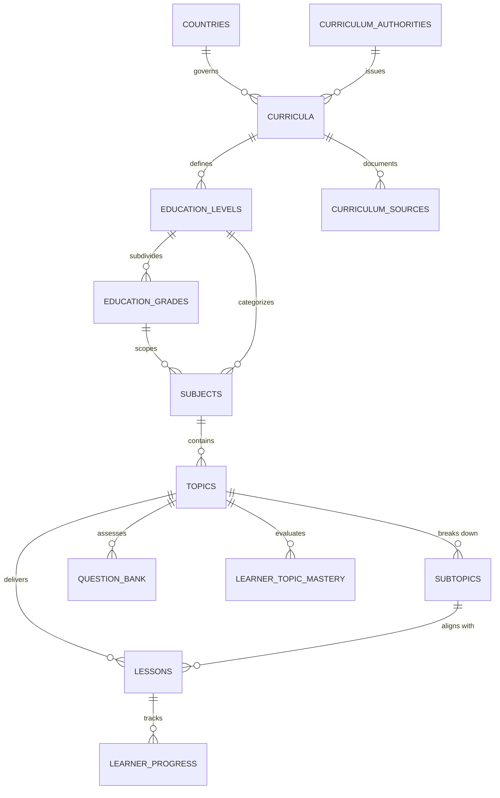

# LearnTZ — TIE Curriculum Data Dictionary
**System Architecture:** Multi-Country Competency-Based Learning System (CBLS)  
**Curriculum Domain:** Tanzania Institute of Education (TIE) Primary Education  
**Database Engine:** PostgreSQL 15+ (Supabase)  
**Schema Version:** 2026.11.16  
**Status:** Authoritative Technical Specification • STAGE D Deliverable  

---

## 1. Entity Hierarchy & Relationship Architecture

---

## 2. Core Curriculum Data Entities

### A. `public.countries`
Stores sovereign jurisdiction metadata ensuring multi-country isolation.
- `country_code` (`text`, PK): ISO 3166-1 alpha-2 uppercase country code (e.g. `'TZ'`, `'KE'`).
- `name` (`text`, NOT NULL): Full official state name (e.g. `'Tanzania'`).
- `is_enabled` (`boolean`, NOT NULL DEFAULT true): System availability flag.
- `created_at` (`timestamptz`, NOT NULL DEFAULT now()).

---

### B. `public.curricula`
Defines national curriculum frameworks.
- `id` (`uuid`, PK DEFAULT `gen_random_uuid()`).
- `country_code` (`text`, FK -> `countries.country_code` ON DELETE RESTRICT).
- `authority_id` (`uuid`, FK -> `curriculum_authorities.id`).
- `code` (`text`, NOT NULL): Stable alphanumeric identifier (e.g. `'tz-tie-2023'`).
- `name` (`text`, NOT NULL): Official title (e.g. `'Mtaala wa Elimu ya Msingi 2023'`).
- `version` (`text`, NOT NULL): Framework version (e.g. `'2023.1'`).
- `is_published` (`boolean`, NOT NULL DEFAULT false).
- `created_at` (`timestamptz`, NOT NULL DEFAULT now()).

---

### C. `public.education_levels`
Defines institutional schooling stages.
- `id` (`uuid`, PK DEFAULT `gen_random_uuid()`).
- `curriculum_id` (`uuid`, FK -> `curricula.id` ON DELETE RESTRICT).
- `code` (`text`, NOT NULL): Level code (e.g. `'PRIMARY'`, `'SECONDARY'`).
- `name` (`text`, NOT NULL): Level display name (e.g. `'Primary Education'`).
- `sequence` (`integer`, NOT NULL CHECK sequence > 0).
- `is_enabled` (`boolean`, NOT NULL DEFAULT true).
- **Unique Constraint:** `(curriculum_id, code)`, `(id, curriculum_id)`.

---

### D. `public.education_grades`
Represents individual academic years / classes (e.g. Standard 1 through 6).
- `id` (`uuid`, PK DEFAULT `gen_random_uuid()`).
- `education_level_id` (`uuid`, NOT NULL).
- `curriculum_id` (`uuid`, NOT NULL).
- `code` (`text`, NOT NULL): Grade code (e.g. `'STANDARD_1'`, `'STANDARD_3'`).
- `name` (`text`, NOT NULL): Grade title (e.g. `'Standard 3'`, `'Darasa la III'`).
- `sequence` (`integer`, NOT NULL CHECK sequence > 0): 1 through 6 for Primary.
- `is_enabled` (`boolean`, NOT NULL DEFAULT true).
- **Foreign Key:** `(education_level_id, curriculum_id)` REFERENCES `education_levels(id, curriculum_id)`.
- **Unique Constraint:** `(education_level_id, code)`, `(education_level_id, sequence)`, `(id, education_level_id, curriculum_id)`.

---

### E. `public.subjects`
Represents official curriculum subject disciplines.
- `id` (`uuid`, PK DEFAULT `gen_random_uuid()`).
- `country_code` (`text`, FK -> `countries.country_code`).
- `curriculum_id` (`uuid`, NOT NULL).
- `education_level_id` (`uuid`, NOT NULL).
- `grade_id` (`uuid`, NULLABLE): References `education_grades(id)`. **Grade-scoped subjects populate this field to ensure strict class isolation.**
- `code` (`text`, NOT NULL): Stable subject code (e.g. `'tie-pri-english-standard3'`, `'tie-pri-kiswahili-standard4'`).
- `name` (`text`, NOT NULL): Common subject name (e.g. `'English Language'`, `'Kiswahili'`).
- `official_name` (`text`): Full regulatory syllabus title (e.g. `'English Language Syllabus for Primary Education — Standard III'`).
- `description` (`text`, NOT NULL DEFAULT ''): Syllabus summary and period weighting.
- `display_order` (`integer`, NOT NULL DEFAULT 1 CHECK display_order > 0).
- `classification` (`text`, DEFAULT `'compulsory'` CHECK classification IN (`'compulsory'`, `'elective'`)).
- `language` (`text`, DEFAULT `'en'`): Primary instructional language (`'en'`, `'sw'`).
- `is_published` (`boolean`, NOT NULL DEFAULT false).
- **Index:** `subjects_scope_code_unique_idx` ON `(curriculum_id, education_level_id, COALESCE(grade_id, '00000000-0000-0000-0000-000000000000'::uuid), code)`.

---

### F. `public.topics` (Specific Competences)
Represents official TIE **Specific Competences (Umahiri Mahususi)**.
- `id` (`uuid`, PK DEFAULT `gen_random_uuid()`).
- `subject_id` (`uuid`, NOT NULL REFERENCES `subjects.id` ON DELETE CASCADE).
- `title` (`text`, NOT NULL): Verbatim Specific Competence statement (e.g. `'Develop listening and speaking skills'`, `'Kutambua matamshi ya sauti mbalimbali'`).
- `summary` (`text`, NOT NULL DEFAULT ''): Main Competence context, weekly period allocation, and scope notes.
- `competency_code` (`text`): Official alphanumeric code (e.g. `'1.1'`, `'1.2'`, `'2.1'`, `'3.1'`).
- `period_allocation` (`integer`): Official number of periods allocated from syllabus matrix table.
- `assessment_criteria` (`text`): Official baseline assessment criteria.
- `source_page` (`integer`): Starting syllabus page reference.
- `display_order` (`integer`, NOT NULL DEFAULT 1).
- `is_published` (`boolean`, NOT NULL DEFAULT true).

---

### G. `public.subtopics` (Learning Activities)
Represents official TIE **Learning Activities (Shughuli za Ujifunzaji)**.
- `id` (`uuid`, PK DEFAULT `gen_random_uuid()`).
- `topic_id` (`uuid`, NOT NULL REFERENCES `topics.id` ON DELETE CASCADE).
- `title` (`text`, NOT NULL): Activity identifier and action statement (e.g. `'(a) Write dictated words'`, `'(a) Kutamka sauti za herufi'`).
- `description` (`text`, NOT NULL DEFAULT ''): Suggested Teaching & Learning Resources (Zana na Vifaa vya Kufundishia).
- `learning_outcome` (`text`, NOT NULL DEFAULT ''): Suggested Teaching & Learning Methods (Mbinu za Ufundishaji na Ujifunzaji).
- `assessment_criteria` (`text`): Concrete official assessment criteria for the activity.
- `period_allocation` (`integer`): Allocated teaching periods for this specific activity.
- `display_order` (`integer`, NOT NULL DEFAULT 1).
- `source_page` (`integer`): Syllabus page citation.
- `is_published` (`boolean`, NOT NULL DEFAULT true).

---

### H. `public.lessons` (Original LearnTZ Digital Lessons)
Proprietary instructional lessons developed by LearnTZ aligned to official competences.
- `id` (`uuid`, PK DEFAULT `gen_random_uuid()`).
- `topic_id` (`uuid`, NOT NULL REFERENCES `topics.id` ON DELETE CASCADE).
- `title` (`text`, NOT NULL): Lesson instructional title.
- `body_markdown` (`text`, NOT NULL): Original pedagogical content, explanations, and worked examples.
- `estimated_minutes` (`integer`, NOT NULL DEFAULT 40): Estimated learner time.
- `display_order` (`integer`, NOT NULL DEFAULT 1).
- `is_free_preview` (`boolean`, NOT NULL DEFAULT false).
- `is_published` (`boolean`, NOT NULL DEFAULT false).

---

### I. `public.question_bank` (Competency Assessments)
Formative and summative assessment items.
- `id` (`uuid`, PK DEFAULT `gen_random_uuid()`).
- `topic_id` (`uuid`, NOT NULL REFERENCES `topics.id` ON DELETE CASCADE).
- `lesson_id` (`uuid`, REFERENCES `lessons.id` ON DELETE SET NULL).
- `question_type` (`text`, NOT NULL): `'multiple_choice'`, `'true_false'`, `'matching'`, `'fill_blank'`, `'short_answer'`.
- `difficulty_level` (`text`, NOT NULL DEFAULT `'medium'`): `'easy'`, `'medium'`, `'hard'`.
- `question_text` (`text`, NOT NULL).
- `options` (`jsonb`): Choices array or matching premise/response map.
- `correct_answer` (`text`, NOT NULL).
- `explanation` (`text`): Remedial feedback and explanation.
- `cognitive_tier` (`text`): Bloom's taxonomy level (`'recall'`, `'application'`, `'analysis'`).
- `display_order` (`integer`, NOT NULL DEFAULT 1).

---

### J. `public.curriculum_sources`
Authoritative source registry and rights clearance tracker.
- `id` (`uuid`, PK DEFAULT `gen_random_uuid()`).
- `document_title` (`text`, NOT NULL).
- `document_reference` (`text`): Official ISBN and page count.
- `issuing_institution` (`text`, NOT NULL DEFAULT `'Tanzania Institute of Education (TIE)'`).
- `publication_date` (`date`).
- `effective_date` (`date`).
- `sha256_checksum` (`text`, NOT NULL): Cryptographic verification hash.
- `verification_status` (`text`, NOT NULL DEFAULT `'unverified'` CHECK verification_status IN (`'unverified'`, `'in_review'`, `'verified'`, `'rejected'`)).
- `usage_rights_status` (`text`, NOT NULL DEFAULT `'unknown'` CHECK usage_rights_status IN (`'unknown'`, `'permission_pending'`, `'authorized'`, `'public_domain'`, `'restricted'`)).
- `usage_rights_note` (`text`): Boundary notes separating reference metadata from proprietary learning materials.

---

## 3. Data Integrity & Validation Rules

1. **Foreign Key Integrity:** Deleting a `subject` cascades to `topics`, `subtopics`, and `lessons`, preventing orphan curriculum nodes.
2. **Period Balance Invariant:** The sum of `subtopics.period_allocation` for a given topic should reconcile to `topics.period_allocation`.
3. **Grade Scoping Rule:** All production subjects must have non-null `grade_id` to prevent multi-grade cross-pollution in the Curriculum Explorer.
4. **Alphanumeric Code Formatting:** Competence codes must adhere to standard TIE notation (`^\d+\.\d+$`, e.g. `1.1`, `2.3`).
